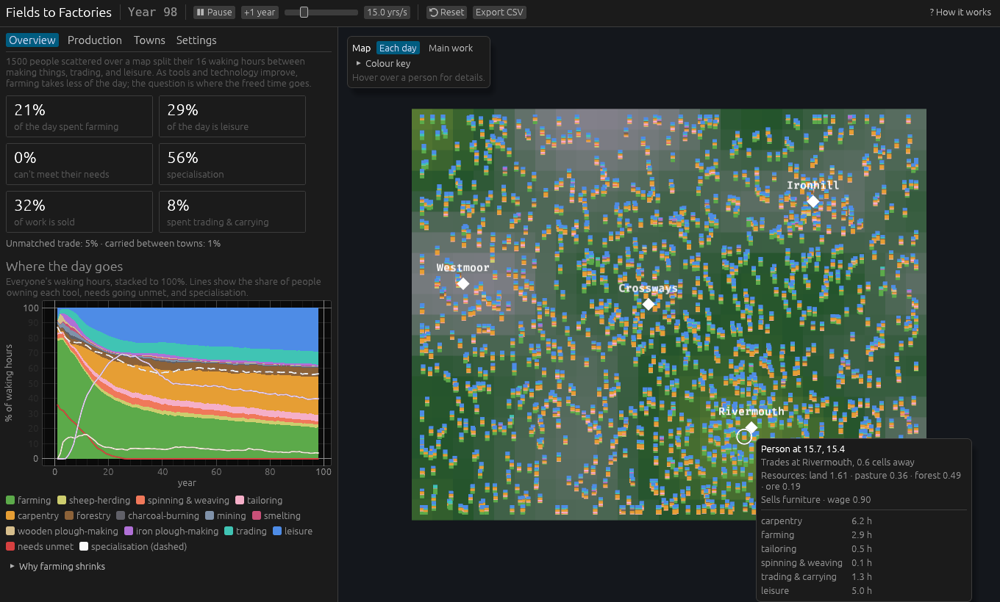

# Fields to Factories

About 1,500 people (you choose how many) are scattered over a 25 × 20 map, settling more densely on good farmland and near towns. Each splits a 16-hour waking day across the goods in an economy, trading at the nearest market town, plus leisure. Three data files define the world:

- [`goods.ron`](goods.ron) holds facts about goods: what each one **provides** (food provides nourishment, clothing provides warmth, furniture provides comfort), how it's made, how fast its recipe improves, and how bulky it is to carry. Raw wool, wood and ore feed chains up to clothing, furniture and ploughs.
- [`people.ron`](people.ron) holds **who** lives here and what they **want**: how many people, their needs and tastes (drawn per person from ranges), and the range of quality for each resource.
- [`map.ron`](map.ron) holds the **geography**: terrain that decides where land, pasture, forest and ore are good, where people settle, the market towns, and the cost of carrying goods.

People work out for themselves what any good is worth to them, including tools, which provide nothing directly but save hours. Every good can be made or bought, whichever costs that person fewer hours, so people with good land end up farming for others and people near rich ore end up mining.

Nothing is scripted. The shift out of farming comes from one relationship:

```
hours farming ≈ nourishment needed ÷ (food per hour × tool boost)
```

The need doesn't grow, so every gain in farm productivity frees hours for everything else. Better ploughs raise the tool boost, but an iron plough sits at the end of a chain: wood → charcoal, plus ore → iron, then iron + wood → plough. Trade lets each person take part in that chain at whichever step suits their land, forest and ore, as long as the trip to market is worth it.



## Run

```sh
cargo run --release                                   # interactive window
cargo run --release -- --headless 300                 # 300 years as CSV on stdout
cargo run --release -- --goods g.ron --people p.ron   # use other definitions (also --map)
cargo run --release -- --show-map                     # print the terrain and towns as text
cargo run --release -- --trade-cost 3 --headless 300  # start with a different trade cost
cargo run --release -- --people-count 3000            # override the number of people
```

The first build compiles Bevy and takes several minutes. On Linux you also need the usual Bevy system packages (`libudev-dev`, `libwayland-dev`, `libxkbcommon-dev`). See Bevy's [Linux dependencies](https://github.com/bevyengine/bevy/blob/main/docs/linux_dependencies.md).

## How people decide

1. **Needs first.** For each need, a person works on the cheapest good that provides it until the need is met, or the day runs out.
2. **Spare hours follow their own tastes,** a quarter-hour at a time: more of what they enjoy, leisure, or tools.
3. **Tools are valued by the hours they save.** A plough is worth the farming hours it saves each year, priced at what a spare hour was worth to that person last year, over the plough's discounted lifetime. Someone with no spare hours values a plough at nothing, so the poorest can't invest.
4. **Tools are whole and wear out at random.** A new tool lasts a number of years drawn from its `lifetime` range, then breaks and must be replaced. Hours put towards a tool build up as progress (or savings, if buying) until there's a whole one. A farmer works with the best tool they own, so an iron plough makes a wooden one pointless.
5. **Make or buy.** For each good, and each input, a person compares making it with earning the money at their job and buying it. Buying also costs time at market: the trade cost, a share of the price. Hours spent making inputs count in those sectors, and hours spent earning count in the job's sectors.
6. **Gradual choices.** The cheaper buying is compared with making, the larger the share of a good a person buys, rather than everyone flipping at once.
7. **Distance.** Everyone trades at their nearest town. Buyers carry goods home and sellers carry goods to market, each costing `travel_cost` × the good's `bulk` × the distance in hours. Far from town, buying and selling cost more, so people make more for themselves.
8. **Jobs.** A person's job is the good they make to sell; their wage is what an hour of it earns after paying for bought inputs. People start out self-sufficient. Each year about one in five reviews their job and picks one, where better-paying jobs are more likely but not certain.

## Markets and towns

Each town has its own prices, measured in **hours of an average person's work**, so an iron plough "costs 19 hours". Each year, a good's price in a town rises if more was bought there than sold, and falls if the opposite. Buyers pay the price plus time at market and carrying; sellers get the price, minus their own carrying time.

**Merchants** link the towns. When one town has surplus and another a shortage, and the price gap is bigger than the cost of carrying the good between them, merchants ship it. Merchants' own time isn't yet counted in anyone's day.

The markets don't clear exactly. Once they've formed, about 5% of trade by value finds no counterpart in a given year. Smaller populations make it worse: with 500 people it was 8–9%, because each town's market was lumpier. Merchants absorb the gap, and prices move to close it. The panel shows this as "unmatched". In the first 10 years, while people are still joining, most trade is unmatched.

## The definitions

Edit any of them and press **Reset** in the app to reload all three without recompiling. Reset also redraws everyone.

**`goods.ron`**: one entry per good.

| Field | Meaning |
|---|---|
| `provides` | What one unit gives a person, e.g. `[("nourishment", 1.0)]`. Tools and inputs provide nothing |
| `recipe.rate` | Units made per hour of work |
| `recipe.uses` | A resource, e.g. `"ore"`, whose per-person quality scales the rate |
| `recipe.improves` | Share the rate grows by each year, e.g. `0.015` for 1.5%, scaled by the "technology improves" setting |
| `recipe.inputs` | Goods used up per unit, e.g. `[("iron", 2.0), ("wood", 2.0)]` |
| `recipe.tools` | Tools that multiply this recipe's output; a person works with the best one they own |
| `lifetime` | Makes the good a tool: the years it lasts before breaking, drawn from the range, e.g. `(15.0, 35.0)` |
| `bulk` | How hard one unit is to carry, relative to food (default 1). Ore is 2, cloth 0.3 |

**`people.ron`**: values are fixed (`1.0`) or a range (`(0.8, 1.2)`) that each person draws from.

| Field | Meaning |
|---|---|
| `count` | How many people live on the map; a fixed number, or a range drawn once per Reset. Default 1500 |
| `endowments` | Range of quality for each resource (`land`, `pasture`, `forest`, `ore`); where in the range a person falls depends on the terrain where they live. Must be above zero |
| `needs` | Amount of a characteristic needed per day; met before anything else, in the order listed (nourishment, then warmth) |
| `preferences` | Enjoyment beyond the need: `Log(weight)` is always wanted at a falling rate; `Saturating(weight, scale)` is wanted until about `scale` extra |
| `leisure` | Weight on free time |
| `discount_rate` | How much less next year matters; with wear, sets how far ahead tools are valued |

**`map.ron`**: run with `--show-map` to see the terrain and where towns sit.

| Field | Meaning |
|---|---|
| `seed`, `feature_size` | Which terrain to generate, and roughly how many cells wide its hills and valleys are |
| `terrain` | Where each resource is best: `Low` (valleys), `Middle` (slopes), `High` (hills) or `Anywhere` |
| `towns` | Market towns, by name and `(column, row)` from the top-left |
| `travel_cost` | Hours to carry one unit of bulk one cell |
| `settlement` | Where people choose to live: denser where the `follows` resource is good (`strength` 0 ignores it; higher crowds the best spots) and up to `1 + near_towns` times denser right beside a town |

The loaders reject unknown goods, duplicate names, tools without a lifetime (or one under a year) or with a multiplier below 1, recipes that are inputs to themselves, wants no good provides, resources with no endowment, towns off the map, terrain or settlement for resources no recipe uses, and a count below 1.

## The window

- **Top bar:** run or pause, step one year, simulation speed, reset (reloading the definition files), export CSV, and **How it works**, a short guide to the model.
- **Map:** each small mark is one person, placed where they live; several can share a cell. The key in its corner switches between **Each day** (a bar of their 16 waking hours, work at the bottom, leisure on top) and **Main work** (coloured by their biggest sector, like a land-use map), and opens a colour key. The ground shows terrain: yellow-green valleys, dark green forest, grey hills; diamonds are market towns. **Hover over anyone** to ring them and see their resources, town, job, wage, how they spent the day and which tools they own.
- **Side panel tabs.** Hover over almost anything for an explanation.
  - **Overview:** headline numbers (farming, leisure, needs unmet, specialisation, work sold, time trading and carrying), the "Where the day goes" chart, and "Why farming shrinks", the core equation with today's numbers.
  - **Production:** the production tree with prices in a chosen town, and how many people own each tool.
  - **Towns:** people, average wage, main work and food price for each town.
  - **Settings:** technology speed, time at market, carrying cost, a slider for every recipe and tool, and the definition files with a reset button.

## Things to try

- **Switch the map to "Main work".** By year 100 the fertile valley round Rivermouth farms, the sheep hills round Westmoor have become a textile district (wool, cloth, tailoring), and carpenters cluster on the forested slopes near their wood. Nothing places them; it's where their resources are.
- **Compare food prices and populations on the Towns tab.** The valley town Rivermouth has the most people (about 470 of 1,500), and at year 100 food costs about 1.2 hours of work there against 1.7–1.9 in the hill towns: the price of carrying it uphill.
- **Watch the hills go hungry, then recover.** Hill farmland is poor, so about 36% of people start out unable to meet their needs. Trade lets them sell wool, wood or furniture and buy food:

  | Needs unmet | Year 10 | Year 20 | Year 30 |
  |---|---|---|---|
  | Cheap trade (5%) | 16% | 1% | 0% |
  | Default (30%) | 19% | 3% | 0% |
  | No trade (300%) | 20% | 10% | 6% |
- **Change the population.** Set `count` in `people.ron` (or run with `--people-count`) and press Reset. Bigger populations give each town a deeper market; try 500 against 3000 and compare unmatched trade.
- **Change where people settle.** In `map.ron`, raise `settlement.strength` to crowd everyone into the valleys and empty the hills, or set it to 0 to spread people evenly.

- **Raise the carrying cost.** Trade shrinks, prices drift further apart between towns, and the regions become more self-sufficient.
- **Move or add a town in `map.ron`,** then press Reset. Put one deep in the western hills and see whether the textile district moves with it.
- **Watch where freed time goes.** Farming shrinks, and so does weaving, which improves fastest (2% a year). Tailoring and carpentry improve slowly (0.5%), so they hold on to workers or grow. This is **Baumol's cost disease**: labour moves into the sectors whose productivity *doesn't* rise.
- **Watch years 2–10.** Cheap wooden ploughs spread first, then iron ploughs take over as a mining, charcoal and smelting chain forms.
- **Export CSV** writes `history.csv` with each good's rate and its price in every town, each sector's share of hours overall and in every town, trading time, specialisation, trade carried between towns, unmatched trade and tool ownership.

## Layout

| File | Contents |
|---|---|
| `goods.ron` | Every good: what it provides and how it's made |
| `people.ron` | What people need and enjoy, and the range of each resource's quality |
| `map.ron` | Terrain, market towns and carrying cost |
| `src/goods.rs` | Loads and validates the catalog; computes rates, tool boosts and embodied hours |
| `src/people.rs` | Loads and validates the population definition; tastes and their curves |
| `src/map.rs` | Loads the map, generates terrain and finds each spot's nearest town |
| `src/market.rs` | Each town's prices, merchants between towns, and each person's make-or-buy routes and job choice |
| `src/sim.rs` | People as ECS components (`Home`, `Endowments`, `Needs`, `Tastes`, `Tools`, `Job`, `Trades`, …), and the `SimTick` schedule: advance technology → plan each day → replace tools → clear the market → record history |
| `src/ui/mod.rs` | The map: terrain, towns, and each person's day or main work |
| `src/ui/panel.rs` | Top bar, tabbed side panel, map key, hover details and the How it works window |
| `src/ui/charts.rs` | The production tree and the history chart |
| `src/main.rs` | Windowed or headless entry point |

See [CHANGELOG.md](CHANGELOG.md) for what each stage added.

## Next: stage 6

Who gains? Wages already differ a lot between people and places. Tracking each person's consumption and leisure would show whether trade and technology spread gains evenly, or whether the best-endowed places pull ahead, and what happens to the remote and the poor.
